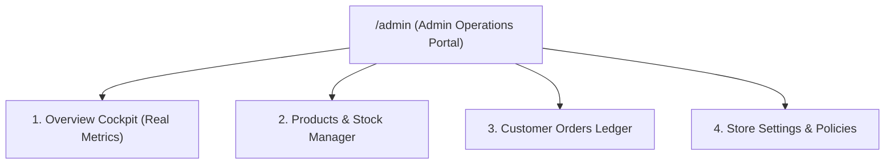

# Admin Dashboard UX & Operations Cockpit Architecture

This skill defines the operational usability standards, dense data table architecture, and workflow ergonomics for the **Purti Creations** back-office administration portal.

---

## 1. When to Apply This Skill
- Designing or modifying administrative routes (`/admin`, `/admin/products`, `/admin/orders`, `/admin/settings`).
- Structuring the operations sidebar, action buttons, table filters, and status toggles.
- Implementing product creation, editing, price confirmation, and image uploads.
- Managing order lifecycles and customer delivery intimations via WhatsApp.
- Ensuring all dashboard KPI cards are computed strictly from real database records.

---

## 2. Core Dashboard Sections

### A. Section 1: Overview Cockpit
- **Hero Metrics**:
  - `Total Orders`: Computed from `SELECT COUNT(*) FROM Order`.
  - `Pending Orders`: Computed from `SELECT COUNT(*) FROM Order WHERE status = 'PENDING'`.
  - `Total Revenue`: Computed from `SELECT SUM(total) FROM Order WHERE paymentStatus = 'PAID'`.
  - `Low Stock Warnings`: Computed from `SELECT COUNT(*) FROM Product WHERE stock <= 5 AND inStock = 1`.
- **Zero Fabricated Analytics**: Never display fake page-views, fake conversion graphs, or artificial revenue numbers.

### B. Section 2: Products & Inventory Management
- **Table Columns**: Image thumbnail, Product Title & Category, Price & Compare-At, Stock count, Confirmed badge, Published status, and Actions (Edit, Delete, Preview).
- **CRUD Modals**:
  - Full title, subtitle, slug, and category assignment.
  - Regular price and optional sale price (`compareAtPrice`).
  - Stock quantity and `inStock` toggle.
  - Image array manager (upload, replace, reorder).
  - Specifications: Dimensions, Materials, Included Accessories, Occasions.
  - Save button with inline validation and confirmation.

### C. Section 3: Customer Orders Ledger
- **Status Lifecycle**: `PENDING` → `CONFIRMED` → `PROCESSING` → `DISPATCHED` → `DELIVERED` → `CANCELLED`.
- **1-Click WhatsApp Intimation**: Direct link to notify the customer on WhatsApp with their exact order reference, item details, and courier tracking details.
- **Privacy Discipline**: Customer addresses and phone numbers are only visible to authenticated admins.

### D. Section 4: Store & Policies Configuration
- Brand name, verified studio phone number, and WhatsApp number.
- Shipping fees and free delivery threshold.
- Return, refund, and shipping policy editors.
